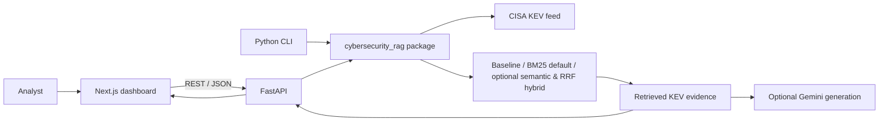

# Cerebro — Cybersecurity Intelligence Assistant

**AI-Powered Cybersecurity Intelligence Assistant**

*Think smarter. Investigate deeper.*

Cerebro provides evidence-first vulnerability intelligence over CISA's Known Exploited Vulnerabilities (KEV) catalogue. It includes a Python CLI, a FastAPI service, and a premium dark SOC-inspired dashboard with teal/cyan accents. BM25 is the default; the original lexical baseline is retained. Semantic and hybrid retrieval are optional and have not been quality-evaluated.

## Architecture



The CISA feed is fetched lazily on the first catalogue request and held in memory for the process. The API returns source CVE identifiers and evidence records alongside generated answers. Without a Gemini key, catalogue retrieval remains available and chat returns the retrieved evidence without claiming an AI answer was generated.

## Features

- CISA KEV catalogue search and CVE details, with an optional exact vendor metadata filter in the CVE Explorer.
- Exact CVE matching and BM25 retrieval by default; original baseline retained.
- Optional local Sentence Transformers and reciprocal-rank hybrid strategies; require optional dependencies/model files not included in the default install.
- Gemini answer generation when configured, with evidence-first prompting.
- API health, catalogue, CVE detail, and chat routes.
- Offline BM25-vs-baseline benchmark against a hash-pinned CISA snapshot.

## Requirements

- Python 3.10+
- Node.js 20+
- Docker Compose is optional for containerized local demonstration.
- Gemini credentials are optional; without them the dashboard still supports KEV exploration and evidence retrieval.

## Run locally (Windows PowerShell)

From the repository root:

```powershell
python -m venv .venv
.\.venv\Scripts\Activate.ps1
python -m pip install -r requirements.txt
Copy-Item .env.example .env
```

Set environment variables in the current PowerShell session. Add a Gemini key only if AI-generated answers are desired:

```powershell
$env:RETRIEVAL_STRATEGY = "bm25"
$env:GEMINI_API_KEY = "" # Optional; set your own key to enable Gemini
$env:FRONTEND_ORIGINS = "http://localhost:3000"
uvicorn cybersecurity_rag.api:app --reload
```

In a second PowerShell terminal:

```powershell
cd frontend
Copy-Item .env.example .env.local
npm install
npm run dev
```

Open <http://localhost:3000>. The API is at <http://localhost:8000>; interactive API docs are at <http://localhost:8000/docs>.

The backend reads process environment variables; it does not load `.env` automatically. `.env` is used by Docker Compose. For local Python runs, set variables in PowerShell as above. Never put real credentials in committed files.

## Configuration

| Variable | Default | Purpose |
|---|---|---|
| `GEMINI_API_KEY` | empty | Optional Gemini credential |
| `GEMINI_MODEL` | `gemini-3.5-flash-lite` | Gemini model name |
| `RETRIEVAL_STRATEGY` | `bm25` | `baseline`, `bm25`, `semantic`, or `hybrid` |
| `CISA_URL` | Official CISA KEV feed | Feed URL |
| `FRONTEND_ORIGINS` | `http://localhost:3000` | Comma-separated CORS origins |
| `NEXT_PUBLIC_API_URL` | `http://localhost:8000` | Browser-visible API base URL |
| `SEMANTIC_MODEL` | `sentence-transformers/all-MiniLM-L6-v2` | Optional local model identifier |
| `SEMANTIC_INDEX_PATH` | `.cache/kev_embeddings.npz` | Local fingerprinted embedding cache |

Semantic/hybrid mode currently requires installing `sentence-transformers` separately and making the model available. The project does not install or download a model automatically; unavailable dependencies produce an explicit API error. BM25 does not depend on Sentence Transformers.

## API

- `GET /health` — service status, configured retrieval strategy, and Gemini-key presence (never returns the key).
- `GET /api/v1/cves?q=...&vendor=...&limit=25&offset=0` — list or retrieve matching KEV records. `vendor` is an optional case-insensitive exact match against CISA's vendor field; BM25 keywords alone do not enforce vendor boundaries.
- `GET /api/v1/cves/{cve_id}` — retrieve one CVE record.
- `POST /api/v1/chat` — JSON body `{"question":"...", "top_k":5}`; returns answer status, evidence records, source CVE identifiers, titles, and CISA links.

Chat statuses distinguish generated answers, insufficient evidence, missing Gemini configuration, and generation errors. CISA/network failures return service-unavailable errors; invalid inputs return validation errors.

## Tests and benchmark

```powershell
python -m pip install -r requirements-dev.txt
python -m pytest -q
python -m benchmarks.run_benchmark --k 3 --repeats 50 --seed 20261106
```

The benchmark compares only baseline and BM25. Its 7 seed judgments are preliminary; 4 expansion judgments are catalog-reviewed, not independently validated by security experts. It is a small development set and does not establish general retrieval quality. No semantic/hybrid benchmark results are claimed. Measurements are machine-specific.

## Docker Compose

Copy `.env.example` to `.env`, optionally set `GEMINI_API_KEY`, then run:

```powershell
docker compose up --build
```

Open <http://localhost:3000>. Stop with `Ctrl+C`, or `docker compose down`. Docker builds fetch their declared Python/Node dependencies from package registries. Deployment to an external host has not been performed.

## Limitations

- Catalogue data is loaded on the first API call and cached in memory; no refresh scheduler or database is included.
- Gemini output is not independently fact-checked. Retrieved CISA records are displayed as supporting sources, but the app does not validate every generated claim against a citation.
- The CISA KEV feed does not provide full NVD enrichment or ATT&CK relationships; neither is represented as if present.
- Semantic and hybrid retrieval are optional, dependency/model availability is unverified here, and retrieval quality has not been benchmarked.
- The benchmark snapshot is pinned to catalog version `2026.11.06` and does not track current feed updates.

## License

MIT. See [LICENSE](LICENSE).
