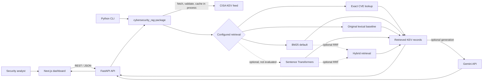
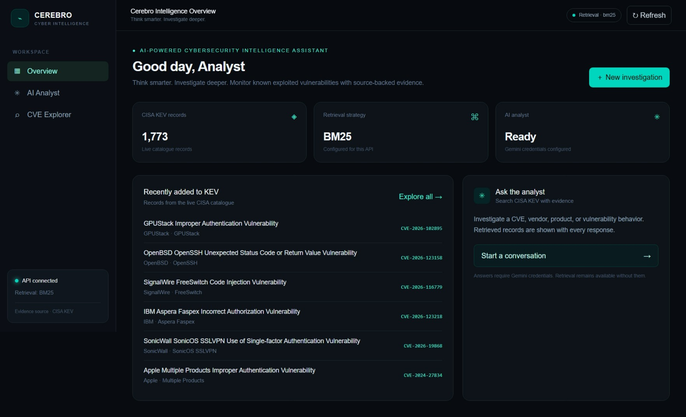

# 🧠 Cerebro

### AI-Powered Cybersecurity Intelligence Assistant

*Think smarter. Investigate deeper.*

Cerebro is an evidence-first vulnerability research assistant for exploring CISA's Known Exploited Vulnerabilities (KEV) catalogue. It combines exact CVE lookup and lexical retrieval with an optional Gemini answer step, exposed through a FastAPI backend and a dark SOC-inspired Next.js dashboard.

> **Project status:** Portfolio MVP with public frontend and API deployments. Gemini is optional. BM25 is the default retrieval strategy. Semantic and hybrid modes are experimental options with no quality evaluation reported. The API is hosted on Render's free tier and may spin down after inactivity, causing cold-start delays.

---

## ⚡ Overview

Security analysts often need to move quickly from a vendor, product, behavior, or CVE identifier to credible vulnerability evidence. Cerebro makes the CISA KEV catalogue searchable and returns the source records beside its answers. When Gemini is not configured, the application remains useful for catalogue search and evidence review without implying that an AI answer was generated.

## 📊 Verified project metrics

| Measure | Verified value | Context |
|---|---:|---|
| Frozen CISA KEV records | 1,769 | Snapshot version `2026.11.06`; SHA-256 verified by the benchmark runner |
| Backend automated tests | 81 passed | Latest complete backend suite before this documentation update |
| Frontend selection tests | 3 passed | Node built-in test runner |
| Retrieval benchmark queries | 11 | 1 exact-CVE query and 10 natural-language queries |
| Natural-language query judgments | 10 | 6 preliminary seeds and 4 catalog-reviewed expansions |
| Semantic/hybrid relevance evaluation | Not performed | No performance or quality claim is made |

Test counts describe the last verified application run, not a continuous integration service. Benchmark figures below are from the recorded 50-repetition runs against the pinned snapshot; they are development measurements, not production service-level claims.

## ✨ Key features

- **CISA KEV Explorer:** search catalogue records and inspect vendor, product, description, date, required action, and available source details.
- **Exact CVE lookup:** prioritize exact identifiers in supported retrieval strategies.
- **BM25 retrieval:** default strategy, with a retained rarity-weighted baseline for comparison.
- **Optional vendor filter:** case-insensitive exact match against CISA's vendor metadata; BM25 keyword scoring alone does not guarantee a single-vendor result set.
- **AI Security Analyst:** optionally ask Gemini to answer using retrieved KEV entries. Retrieved CVEs and CISA source links are shown with the response.
- **Evidence-first fallback:** without a Gemini key, return retrieved records and state that no AI answer was generated; with no retrieval evidence, abstain.
- **Local portfolio interface:** responsive Next.js App Router dashboard with overview, analyst chat, and CVE Explorer views.
- **Reproducible lexical benchmark:** baseline and BM25 are measured against the same pinned CISA snapshot and query labels.

## 🏗️ System architecture



## 🔎 RAG workflow

1. **Load configuration.** BM25 is selected by default; Gemini credentials are optional for retrieval-only use.
2. **Load the catalogue.** On the first catalogue request, the API fetches the CISA KEV JSON feed, checks its response, validates records, and keeps the resulting catalogue in process memory.
3. **Retrieve evidence.** Queries are validated. Exact CVE identifiers are prioritized; otherwise the configured retrieval strategy returns matching catalogue records. A vendor filter, when supplied, is applied against the actual `vendorProject` field.
4. **Abstain when there is no evidence.** The API reports insufficient evidence rather than asking Gemini to answer an unsupported query.
5. **Generate optionally.** With a configured Gemini key, retrieved records are passed to the existing Gemini integration with instructions to treat catalogue text as data, not as executable instructions.
6. **Return answer and sources.** The response includes source CVE IDs, CISA links, and the retrieved evidence. The model's individual claims are not independently validated.

## 📈 BM25 benchmark

The offline benchmark uses CISA KEV catalog version `2026.11.06` (1,769 records, SHA-256 `47e0406b2be5a40420eff66f3d90e83eb8883dae6ff4d08e1b2a942c366f6cc2`). It uses 7 preliminary seed queries and 4 catalog-reviewed expansion queries. “Catalog-reviewed” means checked against source catalogue fields, not independently judged by a security-domain expert.

### Natural-language retrieval metrics

| Cutoff | Strategy | Precision@K | Recall@K | MRR@K |
|---:|---|---:|---:|---:|
| 3 | Baseline | 0.400 | 0.775 | 0.800 |
| 3 | BM25 | 0.500 | 0.975 | 1.000 |
| 5 | Baseline | 0.280 | 0.850 | 0.800 |
| 5 | BM25 | 0.320 | 1.000 | 1.000 |

Exact-CVE evaluation is separate: at both K=3 and K=5, baseline and BM25 each achieved Recall@K 1.000 and MRR@K 1.000 on the single exact-CVE query. P@3 was 0.333 and P@5 was 0.200 because precision uses K as the denominator even when fewer results are returned.

### Recorded retrieval timing

50 warm-query repetitions per query, 20 BM25 index-build repetitions, random strategy order with seed `20261106`. Values are median / nearest-rank p95 milliseconds from the local benchmark environment.

| K | Query set | Baseline warm | BM25 warm | BM25 index build | BM25 cold one-query total |
|---:|---|---:|---:|---:|---:|
| 3 | All 10 natural-language queries | 20.212 / 38.125 | 6.929 / 15.741 | 76.196 / 108.420 | 81.602 / 111.775 |
| 5 | All 10 natural-language queries | 20.707 / 39.606 | 7.469 / 15.355 | 75.857 / 108.168 | 81.371 / 118.504 |

These small-set measurements are machine-specific and include no statistical confidence interval. Warm BM25 excludes index construction; a cold one-query run includes it. Relevance completeness is uncertain, so these figures do not establish general effectiveness or universal performance improvement. The benchmark does not evaluate semantic or hybrid retrieval.

Run it again from the repository root:

```powershell
python -m benchmarks.run_benchmark --k 3 --repeats 50 --seed 20261106
python -m benchmarks.run_benchmark --k 5 --repeats 50 --seed 20261106
```

## 🧰 Technology stack

| Area | Technologies |
|---|---|
| Backend | Python, FastAPI, Pydantic, Requests |
| Retrieval | CISA KEV, exact CVE lookup, BM25, retained lexical baseline |
| Optional generation | Google Gemini `generateContent` API |
| Optional retrieval experiments | Sentence Transformers (`all-MiniLM-L6-v2`), local NumPy embedding cache, reciprocal-rank fusion; not in default dependencies |
| Frontend | Next.js App Router, React, TypeScript, Tailwind CSS |
| Packaging | Docker, Docker Compose |
| Tests | pytest, Node built-in test runner, TypeScript compiler |

## 🔌 API reference

| Method and path | Purpose |
|---|---|
| `GET /health` | API health, configured retrieval strategy, and whether a Gemini key is configured (the key itself is never returned). |
| `GET /api/v1/cves?q=...&vendor=...&limit=25&offset=0` | List/search KEV entries. Optional `vendor` is an exact, case-insensitive match on CISA vendor metadata. |
| `GET /api/v1/cves/{cve_id}` | Return the matching CISA KEV record or a validation/not-found error. |
| `POST /api/v1/chat` | Accept `{"question":"...", "top_k":5}`; return answer status, retrieved evidence, source CVE IDs, and CISA links. |

Chat distinguishes generated answers, insufficient evidence, missing Gemini configuration, and generation errors. Explore the generated schema interactively at `/docs` while running the API locally.

## 📸 Dashboard screenshots

These genuine captures show the deployed Cerebro interface:



*Overview dashboard with the configured BM25 strategy, catalogue summary, and recent CISA KEV entries.*


*CVE Explorer showing catalogue search results and the selected vulnerability's CISA fields.*


*AI Security Analyst response with the retrieved CISA source records displayed alongside the answer.*

The dashboard uses the live CISA catalogue, so the visible record count can differ from the frozen benchmark snapshot described above.

## ⚙️ Installation and configuration

### Local development — Windows PowerShell

From the repository root, create and activate an environment and install the backend dependencies:

```powershell
python -m venv .venv
.\.venv\Scripts\Activate.ps1
python -m pip install -r requirements.txt
$env:RETRIEVAL_STRATEGY = "bm25"
$env:FRONTEND_ORIGINS = "http://localhost:3000"
# Optional: set a real key in your shell to enable generated answers.
$env:GEMINI_API_KEY = ""
uvicorn cybersecurity_rag.api:app --reload
```

In a second terminal:

```powershell
cd frontend
Copy-Item .env.example .env.local
npm ci
npm run dev
```

Open [http://localhost:3000](http://localhost:3000). FastAPI documentation is available at [http://localhost:8000/docs](http://localhost:8000/docs). The backend reads process environment variables directly; it does not load `.env` for local Python execution. Never commit a real key.

### Environment variables

| Variable | Default | Purpose |
|---|---|---|
| `GEMINI_API_KEY` | Empty | Optional Gemini credential; never committed |
| `GEMINI_MODEL` | `gemini-3.5-flash-lite` | Gemini model identifier |
| `RETRIEVAL_STRATEGY` | `bm25` | `baseline`, `bm25`, `semantic`, or `hybrid` |
| `CISA_URL` | Official CISA KEV feed | CISA JSON feed URL |
| `FRONTEND_ORIGINS` | `http://localhost:3000` | Comma-separated CORS origins |
| `NEXT_PUBLIC_API_URL` | `http://localhost:8000` | Browser-visible FastAPI base URL |
| `SEMANTIC_MODEL` | `sentence-transformers/all-MiniLM-L6-v2` | Optional semantic model name |
| `SEMANTIC_INDEX_PATH` | `.cache/kev_embeddings.npz` | Local fingerprinted embedding cache path |

Semantic/hybrid mode requires separately installing `sentence-transformers` and making model files available. This dependency and model are not included in the default installation, and semantic/hybrid retrieval quality has not been measured. BM25 works without them.

## 🐳 Docker

Copy the example configuration and optionally set `GEMINI_API_KEY` in `.env`, then build and start both services:

```powershell
Copy-Item .env.example .env
docker compose up --build
```

The local frontend is served at [http://localhost:3000](http://localhost:3000), and the API at [http://localhost:8000](http://localhost:8000). Stop with `Ctrl+C` or run `docker compose down`. Image builds retrieve declared dependencies from package registries. Public deployments are listed in the Deployment section; the Compose setup remains intended for local demonstration.

## 🧪 Tests

```powershell
python -m pip install -r requirements-dev.txt
python -m pytest -q
cd frontend
npm ci
npm run test:selection
npm run typecheck
npm run build
```

The backend tests mock HTTP boundaries and do not require live CISA/Gemini access. The frontend selection tests use Node's built-in test runner.

## 📁 Project structure

```text
cybersecurity-rag-assistant/
├── cybersecurity_rag/       # Configuration, CISA, retrieval, Gemini, API, app
├── frontend/                 # Next.js dashboard and selection tests
├── tests/                    # Backend unit and API handler tests
├── benchmarks/               # Frozen CISA snapshot, labels, evaluator
├── docs/
│   └── screenshots/          # Genuine dashboard JPEG captures
│       ├── dashboard.jpeg
│       ├── CVE Explorer.jpeg
│       └── AI Analyst.jpeg
├── Dockerfile                # FastAPI service image
├── docker-compose.yml        # Local API + frontend orchestration
├── rag.py                    # Existing CLI entry point
├── search.py                 # Retrieval-only CLI
└── README.md
```

## 🛡️ Security design

- API credentials are read from environment variables and excluded from settings representations; `.env` files are ignored by Git.
- Network clients use finite timeouts and sanitized provider errors.
- CISA records are parsed and validated before they enter retrieval.
- Retrieved feed content is treated as untrusted data in the Gemini prompt, not as instructions.
- Generation is skipped when retrieval yields no evidence; a missing Gemini key leaves evidence retrieval available.
- When optional semantic retrieval is enabled, its embedding cache defaults to a local `.cache` path ignored by Git; no vector database or external retrieval service is used.

## ⚠️ Current limitations

- CISA KEV is the only active vulnerability intelligence source. NVD enrichment and ATT&CK mapping are not implemented.
- The catalogue is fetched lazily and cached in process memory; it has no scheduled refresh, persistent catalogue store, or offline fallback.
- Gemini answers are not validated claim-by-claim against citations. Displayed source records are retrieved evidence, not proof that every generated sentence is supported.
- The benchmark has only 10 natural-language queries and non-expert judgments; expansion labels are source-checked but not independently expert-reviewed.
- Semantic and hybrid strategies need optional dependencies/model files and have no reported retrieval evaluation.
- The public frontend and API are deployed, but no uptime or production service-level guarantee is claimed. The Render free-tier API may spin down after inactivity and take time to cold-start.

## 🚀 Deployment

**Deployment status:** Public portfolio deployment is available. The frontend is hosted on Vercel and the backend API on Render.

- **Frontend:** [https://cerebro-nu-self.vercel.app/](https://cerebro-nu-self.vercel.app/)
- **Backend API:** [https://cerebro-api-3c63.onrender.com](https://cerebro-api-3c63.onrender.com)
- **Health check:** [https://cerebro-api-3c63.onrender.com/health](https://cerebro-api-3c63.onrender.com/health)

The API uses Render's free tier, which can spin down after inactivity; the first request afterward may have a cold-start delay. These links identify the current deployments, not an uptime guarantee.

## 🗺️ Roadmap

- Add a larger, independently reviewed retrieval evaluation set before comparing retrieval strategies for quality.
- Evaluate semantic and hybrid retrieval only after the optional model is available and labels are expanded.
- Add optional NVD enrichment and evidence-backed ATT&CK mappings with provenance and source-level tests.
- Improve citation/claim validation and catalogue refresh behavior.
- Add operational monitoring and reliability hardening for the public demo.

## 👤 Author

**Eshaan49** — Cybersecurity engineering portfolio project focused on vulnerability intelligence and SOC analyst workflows.

[GitHub profile](https://github.com/Eshaan49) · [Cerebro repository](https://github.com/Eshaan49/cybersecurity-rag-assistant)

## 📄 License

MIT License. See [LICENSE](LICENSE).
